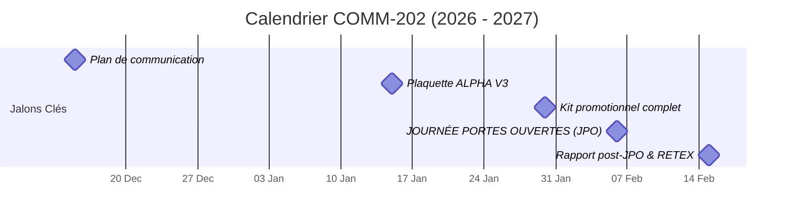

`01 / 06 · PRÉSENTATION EN 180s`

# PROJET COMM-202

Promotion de l'ENSAR sur les salons et la JPO

---

| ÉQUIPE PROJET (MOE) | COMMANDITAIRES (MOA) | ÉCHÉANCE |
| :--- | :--- | :--- |
| **Paul Berthaut** (Chef de projet) **Ahmat Saleh** **Serigne Mbaye** | **Direction ENSAR** (J.-M. Bascans) **BDE ENSAR** | **20 octobre 2026** Pitch 180 secondes |

<!--
Notes de pitch — Slide 1 (0:00 - 0:30 | 30 secondes) :
"Bonjour à tous, bonjour aux membres du jury.
Nous sommes Paul Berthaut, Ahmat Saleh et Serigne Mbaye, et nous vous présentons le projet COMM-202 : la stratégie de promotion et de rayonnement de l'ENSAR pour l'année 2026-2027, mandatée par la Direction et le BDE."
-->

---

`02 / 06 · POURQUOI CE PROJET ?`

# Le Constat et l'Ambition

Transformer les Défis en Opportunités de Rayonnement

- **Alerte JPO :** Faible affluence constatée l'après-midi lors de la dernière édition.
- **Supports Obsolètes :** Nécessité d'actualiser la plaquette ALPHA en version 3 (V3).
- **Cibles Élargies :** Attirer les lycéens, les élèves de CPGE, les BUT et les réorientations.

> **L'AMBITION DE L'ÉCOLE :**  
> Une école d'ingénieurs d'excellence à faire rayonner. Renforcer notre notoriété pour attirer les meilleurs profils et faire de l'ENSAR un choix d'évidence.

<!--
Notes de pitch — Slide 2 (0:30 - 1:00 | 30 secondes) :
"Partons du constat : lors de la dernière JPO, nous avons constaté une fréquentation insuffisante l'après-midi, et nos supports promotionnels, notamment la plaquette ALPHA, doivent être modernisés d'urgence.
L'ENSAR forme d'excellents ingénieurs, mais notre notoriété doit franchir un cap. Notre ambition est claire : élargir le vivier de recrutement aux lycéens, prépas et BUT."
-->

---
layout: two-cols
---

`03 / 06 · STRATÉGIE`

# Nos 3 Piliers d'Action

Un Dispositif Structuré et Cohérent

### 1. Communication
- **Plan de communication** événementiel
- **Plaquette ALPHA V3** print & web
- **Kit de promotion** (kakémonos, vidéos)

::right::

### 2. Événementiel
- **JPO 2027** scénarisée et animée
- **Salons de l'Étudiant** optimisés
- **Ambassadeurs** étudiants formés

### 3. Bilan & Pérennisation
- **Rapport post-JPO** complet
- **Analyse RETEX** pour l'école
- **Mesure de conversion** des visiteurs

<!--
Notes de pitch — Slide 3 (1:00 - 1:30 | 30 secondes) :
"Pour répondre à cette ambition, nous structurons notre mission autour de trois piliers complémentaires :
D'abord, la Communication : refonte totale de la plaquette ALPHA en V3 et création d'un kit de com percutant.
Ensuite, l'Événementiel : une organisation professionnelle de la JPO et des salons avec des étudiants ambassadeurs briefés.
Enfin, le Bilan : un RETEX rigoureux pour mesurer le taux de transformation et pérenniser la méthode pour les futures promotions."
-->

---

`04 / 06 · GOUVERNANCE`

# L'Organisation de l'Équipe

Une Répartition Claire des Responsabilités

| Rôle | Acteurs | Statut & Mission |
| :--- | :--- | :--- |
| **MOA (Commanditaire)** | **Direction ENSAR** & **BDE** | Cadrage stratégique & validation des livrables |
| **Chef de Projet** | **Paul Berthaut** | Pilotage global, planification & coordination |
| **Équipe MOE** | **Ahmat Saleh** & **Serigne Mbaye** | Réalisation des supports, logistique & déploiement |
| **Appui & Conseil** | **Auteurs ALPHA V2** | Rex historique & transmission des acquis |

<!--
Notes de pitch — Slide 4 (1:30 - 2:00 | 30 secondes) :
"Une équipe bien coordonnée est la clé du succès.
Notre gouvernance est limpide : la Direction de l'ENSAR et le BDE assurent la maîtrise d'ouvrage.
Paul Berthaut pilote le projet et les jalons.
Ahmat Saleh et moi-même, Serigne Mbaye, assurons la réalisation opérationnelle des supports et la logistique événementielle, avec l'appui des anciens auteurs d'ALPHA V2 pour capitaliser sur l'existant."
-->

---

`05 / 06 · PLANNING OPÉRATIONNEL`

# Calendrier Prévisionnel

5 Jalons Majeurs jusqu'au Bilan Final

| Date Clé | Jalon Opérationnel | Livrable Attendu |
| :--- | :--- | :--- |
| **15 Déc. 2026** | **Plan de com.** | Validation de la stratégie multicanal |
| **15 Janv. 2027** | **Plaquette V3** | Bon à tirer (BAT) numérique & papier |
| **30 Janv. 2027** | **Kit promo** | Kakémonos, flyers et diapositives prêts |
| **06 Fév. 2027** | **JPO ENSAR** | Accueil, visites guidées et stands actifs |
| **15 Fév. 2027** | **Bilan final** | Remise du rapport RETEX à la Direction |

<!--
Notes de pitch — Slide 5 (2:00 - 2:30 | 30 secondes) :
"Voici notre feuille de route millimétrée :
- 15 décembre : validation du plan de com global.
- 15 janvier : livraison de la plaquette ALPHA V3.
- 30 janvier : déploiement du kit promotionnel.
- Samedi 6 février : le jalon critique, la Journée Portes Ouvertes.
- Et le 15 février : remise officielle du rapport post-JPO et de nos recommandations stratégiques."
-->

---

`06 / 06 · ENGAGEMENT & DÉCISION`

# Décision et Prochaines Étapes

Passer à l'Action pour le Succès de l'ENSAR

- **Validation Officielle :** Approbation de la fiche de cadrage et des jalons proposés.
- **Lancement Opérationnel :** Activation immédiate des groupes de travail avec le BDE.
- **Objectif Partagé :** Faire de la JPO du 6 février 2027 une réussite historique pour notre école.

> *"L'excellence de notre formation mérite une visibilité à sa hauteur."*

### Merci de votre attention !
**Paul Berthaut · Ahmat Saleh · Serigne Mbaye**  
*Nous sommes à votre disposition pour vos questions.*

<!--
Notes de pitch — Slide 6 (2:30 - 3:00 | 30 secondes) :
"Pour concrétiser cette dynamique, nous sollicitons aujourd'hui votre validation formelle de la fiche de cadrage afin de lancer immédiatement la conception des maquettes avec le BDE.
L'ENSAR mérite une visibilité à la hauteur de son excellence.
Merci pour votre confiance et votre attention, nous sommes à votre écoute pour échanger !"
-->
