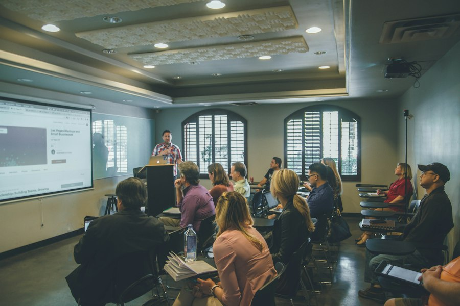

`01 / 02 · PROJET COMM-202`

# Promotion de l'ENSAR

Rayonnement, Attractivité & Recrutement Étudiant

### Le Défi Attractivité

- **Alerte JPO :** 20 à 30 visiteurs seulement
- **Plaquette ALPHA :** Refonte V3 urgente
- **Cible Élargie :** Prépas, Lycées, BUT, Réorientations
- **Cap Direction :** Booster la notoriété ENSAR

::right::

<!--
Notes de pitch — Slide 1 (0:00 - 1:30 | 90 secondes) :

[0:00 - 0:25] Accroche & Choc du Constat :
"Bonjour à tous, bonjour aux membres du jury.
Nous sommes Paul Berthaut, Ahmat Saleh et Serigne Mbaye, et nous portons le projet COMM-202.
Partons d'un chiffre marquant : lors de la dernière Journée Portes Ouvertes, seuls 20 à 30 visiteurs ont franchi les portes de l'ENSAR le matin, avec une affluence quasi nulle l'après-midi. Pour une grande école d'ingénieurs d'excellence comme la nôtre, ce n'est pas concevable. Le constat est limpide : notre école a une valeur immense, mais un déficit critique de visibilité extérieure."

[0:25 - 1:00] La Commande & Les Enjeux :
"Face à ce défi, la Direction de l'ENSAR — sous l'impulsion de Jean-Marc Bascans — et le BDE nous ont confié une mission claire : repositionner l'école au premier plan.
Cela suppose deux impératifs :
D'abord, élargir notre vivier de recrutement. Nous ne ciblons pas seulement les classes prépas, mais aussi les lycéens, les BUT et les étudiants en réorientation.
Ensuite, renouveler nos supports devenus obsolètes : la fameuse plaquette ALPHA doit être intégralement repensée pour délivrer sa troisième version, plus moderne et plus impactante."

[1:00 - 1:30] La Vision Stratégique :
"Notre ambition avec le projet COMM-202 ne se limite pas à distribuer des prospectus. Nous voulons créer une véritable machine d'attractivité qui attire, rassure et convainc les futurs talents de rejoindre l'ENSAR.
Voyons immédiatement notre plan de bataille et nos jalons opérationnels."
-->

---
layout: two-cols
---

`02 / 02 · PLAN DE BATAILLE & JALONS`

# De l'Action aux Résultats

Dispositif Multicanal et Échéances Maîtrisées

### Livrables & Calendrier

- **Plaquette ALPHA V3 :** Print & digital modernisés
- **Kit Promotion :** Kakémonos, flyers, vidéos immersives
- **JPO 6 Février 2027 :** Accueil scénarisé et stands pros
- **Bilan RETEX 15 Fév :** Analyse d'impact et pérennisation

::right::

<!--
Notes de pitch — Slide 2 (1:30 - 3:00 | 90 secondes) :

[1:30 - 2:05] Les Livrables Concrets (La Boîte à Outils) :
"Pour transformer cette vision en résultats concrets, notre démarche repose sur des livrables tangibles et mesurables.
Premier livrable : la Plaquette ALPHA Version 3, déclinée en version imprimée pour les salons et en format interactif numérique pour le web et les réseaux sociaux.
Deuxième livrable : le Kit de Promotion complet. Des kakémonos percutants, des flyers épurés, des supports de présentation harmonisés et des capsules vidéo courtes donnant la parole aux élèves-ingénieurs pour incarner l'expérience ENSAR."

[2:05 - 2:40] Le Jalon Décisif : La JPO du 6 Février 2027 :
"Le point d'orgue de notre dispositif, c'est le samedi 6 février 2027.
Nous allons métamorphoser la Journée Portes Ouvertes :
- Une communication multicanal intensive en amont pour multiplier l'affluence par dix.
- Une animation professionnelle des stands sur les Salons de l'Étudiant et à la JPO, avec des étudiants ambassadeurs formés et briefés.
- Et enfin, le 15 février 2027, la remise du rapport RETEX complet au Directeur pour pérenniser ces méthodes pour les promotions futures."

[2:40 - 3:00] Conclusion Percutante & Appel :
"En conclusion : l'excellence académique de l'ENSAR mérite une visibilité à sa hauteur. Avec COMM-202, nous faisons de l'ENSAR un choix d'évidence et de fierté pour les futurs ingénieurs de demain.
Merci de votre attention, nous sommes désormais à l'écoute de vos questions !"
-->
