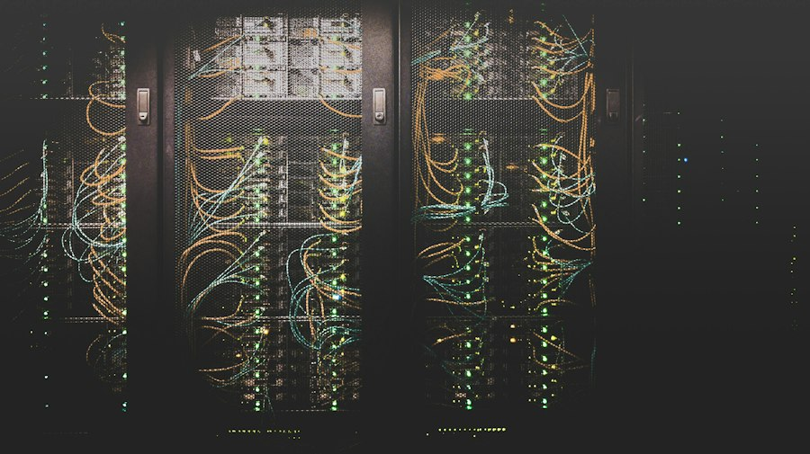

`01 / 06`

# European AI Sovereignty

Breaking the Cloud Monopoly

### Core Shock

- **80%** US Cloud Dominance
- **Hostage Data**
- **Monopoly Lock-In**
- **US Cloud Act**

::right::

<!--
Presenter Notes (0:00 - 0:50):
- Hook: Look around you. Every email we send, every document we store, every hospital record in Europe sits on servers owned by three American companies.
- 80% of European data is on US clouds, subject to the US Cloud Act without European court oversight.
- Today, I will convince you that breaking this monopoly is not an option—it is Europe's fight for independence.
-->

---
layout: two-cols
---

`02 / 06`

# The Agentic Shift

From Chatbots to Autonomous Actions

### The Threat

- **Agentic AI Takeover**
- **Direct System Execution**
- **Sensitive Workflows**
- **Outsourced Decisions**

::right::

<!--
Presenter Notes (0:50 - 1:40):
- Tone: Serious, forward-looking.
- Transition: Why is this urgent in 2026? We are leaving the chatbot era.
- Explanation: AI is becoming Agentic—autonomous software executing code, accessing bank accounts, and running supply chains.
- Core Question: If we don't control the weights and models behind these agents, we are outsourcing European decision-making.
-->

---
layout: two-cols
---

`03 / 06`

# The Physical Layer

Concrete, Silicon & Gigawatts

### Physical Chokepoints

- **Gigawatt Grids**
- **Datacenter Invasion**
- **Hardware Hegemony**
- **Foreign Compute**

::right::

<!--
Presenter Notes (1:40 - 2:30):
- Tone: Grounded in physical reality.
- Insight: People talk about the cloud like it's in the sky. In reality, AI is concrete, water cooling, and gigawatts of electricity.
- The Geopolitical Risk: Foreign giants consume our green European energy while all the profits and leverage stay in California. Compute must be a sovereign public utility.
-->

---
layout: two-cols
---

`04 / 06`

# Open Source Shield

European Models & Local Sovereign Clouds

### The Counter-Attack

- **Open Source Defense**
- **Mistral AI Frontier**
- **Local OVH / Scaleway**
- **Data Privacy Fortress**
- **Zero Lock-In**

::right::

<!--
Presenter Notes (2:30 - 3:30):
- Tone: Optimistic, empowering.
- Solution: Is it too late? Absolutely not. Europe's secret weapon is open source.
- Concrete examples: Champions like Mistral in Paris, hosted on European clouds like Scaleway or OVH, prove that open models compete at the frontier. You own the weights, you control the data, and no foreign CEO can shut you down.
-->

---
layout: two-cols
---

`05 / 06`

# Strategic Crossroads

Digital Colony or Tech Powerhouse?

### The Choice

- **Digital Vassal**
- **Technological Master**
- **Brain Drain Crisis**
- **Action**

::right::

<!--
Presenter Notes (3:30 - 4:20):
- Tone: Inspiring call to action, strong eye contact with classmates.
- Conclusion: This debate is not just for computer scientists. It is the defining geopolitical choice of our decade.
- Direct appeal: Will Europe remain a digital colony paying rent to foreign monopolies, or will we fund our own infrastructure and keep our best engineers? Sovereignty is the freedom to choose our own future.
-->

---
layout: two-cols
---

`06 / 06`

# References & Debate

Sources & Classroom Discussion

### Documented Sources

- **European Commission** · AI Act & Cloud Strategy
- **Financial Times** · Europe's Cloud Dilemma
- **Gartner** · Enterprise Agentic AI (2026)
- **Mistral AI** · Sovereign Compute Papers

::right::

### Discussion Question

> Should European public institutions be legally banned from using foreign proprietary AI?

<!--
Presenter Notes (4:20 - 5:00):
- Closing: Thank you for your attention.
- Audience engagement: Open the floor with the debate question on the slide: Should our schools, universities, and hospitals be required by law to use sovereign open-source AI instead of American proprietary tools?
-->
